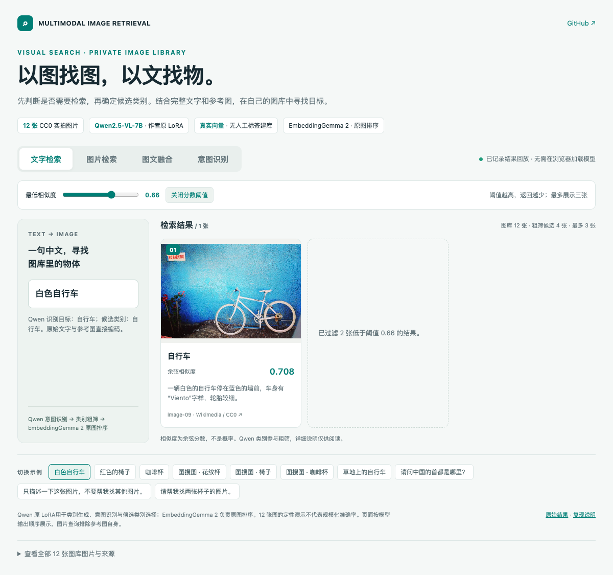

# Multimodal Image Retrieval

**Search your image library with text, a reference image, or both.**

[Online demo](https://liangjianshu.github.io/multimodal-image-retrieval/) · [中文文档](README.md) · [Issues](https://github.com/liangjianshu/multimodal-image-retrieval/issues)

A learning and prototyping project for visual product search and private image libraries. The default **Qwen + EmbeddingGemma 2** pipeline first decides whether image retrieval is needed, filters candidate categories, then ranks original image embeddings with the complete user text and reference pixels.

Qwen predicts gallery labels and normalizes related category names offline. Every request, including image-only queries, goes through Qwen routing. Nonretrieval requests stop before embedding or index search. Qwen summaries do not replace the original user input. Pure embedding and historical Taiyi-CLIP workflows remain explicit baselines.

The project is independent of Alibaba/Taobao; product search describes an application scenario, not their implementation.

## Recorded showcase

[](https://liangjianshu.github.io/multimodal-image-retrieval/)

Ten recorded requests use 12 CC0 photographs: the earlier seven searches, two nonretrieval requests and one explicit quantity request. The showcase uses **Qwen2.5-VL-7B with the author's original LoRA**; saved adapter tensors are checked against the loaded model. Category labels and grouping are model-generated, not handwritten retrieval labels. Reference images are excluded from their own results.

The online demo and standalone `docs/demo/index.html` replay actual outputs, not a live inference service. See [results](docs/demo/results.json), [reproduction and timing](docs/DEMO.md) and [image sources](examples/showcase/SOURCES.md). Public Qwen weights can run the workflow; reproducing the fine-tuned showcase requires the original adapter, which is not distributed here.

The replay defaults to a uniform cosine threshold of **0.66**. Turning off the score threshold restores results after category filtering; it does not bypass Qwen. Raw JSON remains unfiltered by this display threshold. The threshold is selected on these examples and is not independently calibrated.

This small qualitative showcase does not establish general accuracy or the benefit of fine-tuning. Category routing can reduce recall; raw inputs can still contain conditions that the embedding does not rank correctly. [Pure embedding results](docs/demo/baseline-embeddinggemma2/results.json) and [historical results](docs/demo/baseline-taiyi-clip/results.json) are preserved.

## Use your own images

```bash
git clone https://github.com/liangjianshu/multimodal-image-retrieval.git
cd multimodal-image-retrieval
python -m venv .venv-hybrid
source .venv-hybrid/bin/activate
# Install the matching PyTorch build for your hardware first.
pip install -e '.[hybrid]'
python -m mmretrieval prepare --image-root data/images --output data/catalog.jsonl
python -m mmretrieval index --manifest data/catalog.jsonl \
  --image-root data/images --output artifacts/index-hybrid
python -m mmretrieval search --index artifacts/index-hybrid \
  --image-root data/images --text '红色木质椅子' --top-k 5
```

A custom JSONL manifest needs stable IDs and relative paths. Categories and descriptions can be empty; default indexing generates separate prediction fields:

```json
{"id":"chair-001","file_path":"chair/001.jpg","categories":[],"description":""}
```

Add `--image queries/reference.jpg` for an image-only or joint query. Images are processed on the machine running the model. The initial run downloads public weights. Rebuild the index when changing model weights, dimensions, image preprocessing or gallery images. Index/model mismatches are rejected.

The `hybrid` extra pins Transformers 5.22.1, Sentence Transformers 6.2.0, PEFT 0.20.0 and qwen-vl-utils 0.0.14. Both models run in the same inference environment. Default configuration uses the public Qwen base; set `adapter` to use your own compatible LoRA and rebuild the index.

Pure embedding uses `configs/embeddinggemma2.json` and `.[gemma]`. Qwen training and historical Taiyi-CLIP use `.[models]` (Transformers 4.57.1) in a **different environment**. Ascend users must preserve vendor-matched PyTorch/torch_npu. EmbeddingGemma uses BF16/FP32, not FP16.

The index is an in-memory NumPy matrix. Each CLI invocation loads Qwen; EmbeddingGemma loads lazily only for a retrieval request with candidates. A service should reuse both instances. A live web backend, incremental indexing, external vector database and production concurrency are not implemented. Query timings that include Qwen generation are materially different from encoder-only latency; see the recorded measurements.

## Development and documentation

```bash
pip install -e '.[dev]'
pytest -q
python -m mmretrieval demo --output artifacts/demo
```

The no-model demo uses synthetic vectors only to check data flow. Historical Qwen training tests use a tiny randomly initialized model; they do not establish training convergence or the historical F1 gains.

[Custom data](docs/CUSTOM_DATA.md) · [Legacy Qwen training](docs/TRAINING.md) · [Historical experiments](docs/EXPERIMENTS.md) · [Verification](docs/VERIFICATION.md) · [Contributing](CONTRIBUTING.md)

[MIT](LICENSE) for project code, except separately licensed files. Qwen sources retain Apache-2.0 and showcase photos are CC0. Model weights follow their own terms and are not distributed. See [third-party notices](THIRD_PARTY_NOTICES.md).
