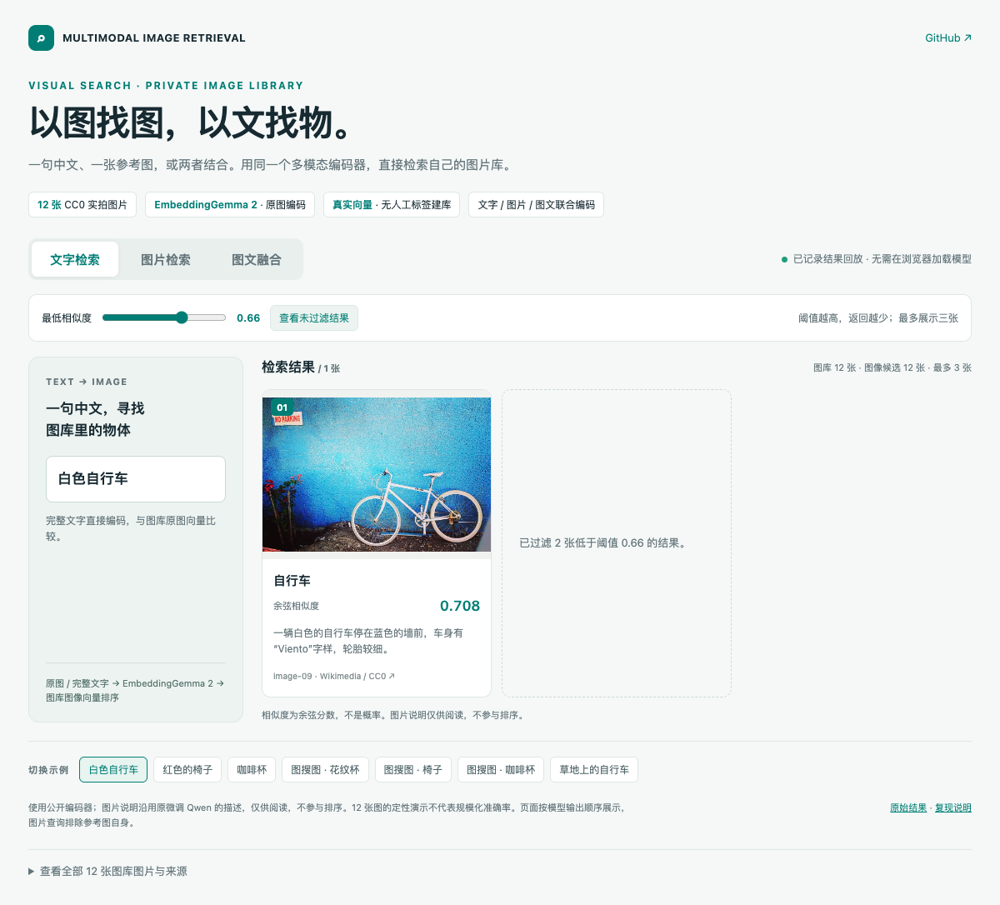
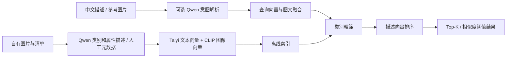

# 图搜图 / 文搜图：拍立淘式商品搜索与私有图库检索

[](https://github.com/liangjianshu/multimodal-image-retrieval/actions/workflows/tests.yml)
[](LICENSE)

[在线演示](https://liangjianshu.github.io/multimodal-image-retrieval/) · [English overview](README.en.md) · [使用反馈 / Issues](https://github.com/liangjianshu/multimodal-image-retrieval/issues) · [参与贡献](CONTRIBUTING.md)

**给一张图，找相似商品；写一句话，搜自己的图片库。**

Visual Product Search · Text-to-Image Search · Multimodal Retrieval

**也适合个人学习多模态与 Agent 应用相关技术栈**：从图文编码、意图解析、检索流程和模型调用入手，进一步实践 LoRA / SFT 微调与效果评测。

面向**电商商品搜索、图片素材库、设计参考图和企业图片资料检索**，支持中文文搜图、参考图搜图和图文融合查询。将自己的图片及元数据接入后，即可建立独立图库并运行检索；需要适配细分领域时，可进一步进行 LoRA / SFT 微调。

“拍立淘式”指上传参考图寻找相似商品的应用场景。本项目是个人实践，未与淘宝或阿里建立关联，也不代表其线上技术实现。拍立淘的公开场景介绍见 [阿里云官方说明](https://www.alibabacloud.com/help/en/image-search/product-overview/scenarios)。

**快速入口：** [真实效果演示](docs/DEMO.md) · [换成自己的数据](docs/CUSTOM_DATA.md) · [领域微调](docs/TRAINING.md) · [实验与效果记录](docs/EXPERIMENTS.md)

## 先看真实检索效果

[](https://liangjianshu.github.io/multimodal-image-retrieval/)

演示图库包含 **12 张可公开分享的 CC0 图片**，覆盖椅凳、杯子和自行车。Qwen2.5-VL-3B 从图片生成类别与描述，Taiyi-CLIP 编码并执行检索，**没有用人工类别或预设向量代替模型输出**。提供 9 组文搜图、图搜图、图文融合结果，包括 CLIP / 语义方法对照和未命中首位的困难案例。

- **直接体验**：[打开在线演示](https://liangjianshu.github.io/multimodal-image-retrieval/)，无需下载仓库或模型。也可查看 [图搜图截图](docs/demo/image-search.png) · [图文融合截图](docs/demo/fusion-search.png)。
- **本地交互查看**：用浏览器打开 `docs/demo/index.html`，切换查询、查看图片描述与来源。图片已内嵌，单独复制这个 HTML 也能显示；禁用脚本的预览可查看首组结果。页面回放已记录结果，不在浏览器里运行模型。
- **自己复跑**：按 [演示与复现指南](docs/DEMO.md) 执行；图片、查询、模型配置、生成描述和原始结果均已附上。

这是公开基座模型在小图库上的定性演示，未加载领域 LoRA，不代表规模化准确率，也不是历史 F1 提升的复现实验。

## 可以用在哪些场景

| 应用场景 | 用户怎么搜 | 接入自己的什么数据 |
| --- | --- | --- |
| **电商图搜商品 / 相似款发现** | 上传一张椅子或鞋子的图片，找外观相近的款式 | 商品图片、商品 ID、类别和属性描述 |
| **文字搜商品** | “红色木质椅子”“白色陶瓷咖啡杯” | 商品图片、类别与可见属性；商品标题可整理进描述 |
| **图片素材库 / 设计参考图检索** | “客厅里的红色沙发”，或上传参考图寻找相似素材 | 摄影图库、设计素材、家居参考图及描述 |
| **企业私有图片资料库** | 用自然语言找产品展示图、样品图和历史素材 | 自有图片目录及人工整理的类别/描述 |
| **业务数据库中的图片资产检索** | 先找到图片，再按结果 ID 查看对应商品或业务记录 | 将数据库里的图片 ID、文件路径和描述导出为 JSONL；结果按 ID 回查 |

这些是可适配的应用方向，当前提供命令行检索原型。找“视觉相似款”与严格识别“同品牌、同型号的同款”需要不同的数据和评测，后者尚未在本项目中验证。数据库场景采用**导出图片清单 → 检索 → 按 ID 关联业务记录**的接入方式，原生数据库连接器与业务界面需要自行集成。

## 为什么用这个项目验证你的图库

- **先接数据，再决定是否训练**：支持类别文件夹和 JSONL 清单，已有图片库可先建立检索基线。
- **图片与文字都能查**：支持纯文本、参考图，以及参考图加文字描述的融合查询。
- **图片描述离线生成**：Qwen 提取类别和属性后建立向量索引，普通查询不必逐张调用大模型。
- **训练和评测入口齐全**：可构造易混淆类别问答，对比微调范围，并通过自有查询集检查效果。
- **默认在本机处理图片**：图片由运行机器上的模型处理；首次使用需下载模型权重。

本项目整理自个人多模态检索实验，包含 Taiyi-CLIP 图文编码、Qwen2.5-VL 语义建库、类别粗筛与描述向量排序，以及可选的领域 SFT。适合学习、验证小规模图片素材库的检索方案。

`mmretrieval/` 是统一运行入口；`legacy/` 保存经过凭据和个人路径清理的历史源码，供追溯实验设计。**模型权重、原始 COCO / ImageNet 图片、个人训练数据与大型向量文件没有上传。**

## 能做什么

| 能力 | 作用 |
| --- | --- |
| 文搜图、图搜图、图文融合查询 | 中文描述、参考图或两者结合，返回图片 ID、路径与相似度 |
| 离线语义建库 | 用 Qwen 提取类别与属性描述，预先编码，查询时不必逐张调用大模型 |
| 两阶段检索 | 按类别向量筛选，再按描述向量排序；提供 CLIP 图像向量基线 |
| 可选意图解析 | 把自然语言请求转换为是否检索、检索描述和返回数量 |
| 可替换数据与模型 | 图片清单、模型 ID / 本地路径、LoRA 适配器和阈值均可配置 |
| 可选领域训练 | 对比语言侧 LoRA、MLP＋LLM、MLP＋Vision；保存训练范围与参数量 |

检索目前使用 **NumPy 内存向量矩阵**，没有接入独立向量数据库，也没有跨编码器精排模型。大规模索引、在线服务、权限管理与并发调度需要进一步开发。

## 流程



## 1. 安装和无需模型的检查

Python 3.10+。建议在 Linux CUDA 环境运行真实模型；本地 CPU 可执行数据处理和流程测试。

```bash
git clone https://github.com/liangjianshu/multimodal-image-retrieval.git
cd multimodal-image-retrieval
python -m venv .venv
source .venv/bin/activate
pip install -e .
python -m mmretrieval demo --output artifacts/demo
```

`demo` 会生成六张几何图片，并完成清单校验、索引保存/加载、检索和训练集划分。它使用**预设的合成向量**，只检查程序连接是否正常，不下载模型，也不代表模型检索效果。

运行真实检索和训练时再安装：

```bash
pip install -e '.[models]'
```

CUDA 用户应先按 [PyTorch 安装说明](https://pytorch.org/get-started/locally/) 安装匹配硬件的 PyTorch。依赖采用 Transformers 4.57.1、PEFT 0.17.1；不要直接升级到 Transformers 5.x 后假定接口兼容。模型按命令需要加载；`prepare` / `validate` / `make-sft` 不加载模型。

## 2. 换成自己的数据（从这里开始）

不需要沿用 COCO / ImageNet。准备你有权使用的图片，可以按类别分文件夹：

```text
data/images/
├── chair/001.jpg
├── chair/002.jpg
├── sofa/001.jpg
└── cup/001.jpg
```

```bash
python -m mmretrieval prepare \
  --image-root data/images \
  --category-map examples/category_map.json \
  --output data/catalog.jsonl

python -m mmretrieval validate \
  --manifest data/catalog.jsonl --image-root data/images
```

`category_map.json` 把目录名映射为中文标签，不限制类别数量；换业务时直接修改。也可以不传映射，保留目录名。平铺图片目录不会自动猜测类别，后续可运行 `describe` 生成检索元数据。

你也可以直接生成 JSONL，一行一张图：

```json
{"id":"chair-001","file_path":"chair/001.jpg","categories":["椅子"],"description":"一把红色木质椅子"}
```

- `id`：唯一且稳定的字符串，用于评测关联。
- `file_path`：相对 `--image-root` 的路径，不能使用旧服务器绝对路径。
- `categories`：人工标签；仅检索时可以为空，训练前必须核对。
- `description`：可选人工描述；没有描述时可先运行下一步。

图片不会被上传到外部 API；默认模型在运行机器上推理，首次使用会从模型托管平台下载权重。完整字段、数据替换清单与 COCO 导入示例见 **[自有数据指南](docs/CUSTOM_DATA.md)**。

## 3. 生成语义描述并建立索引

```bash
python -m mmretrieval --config configs/default.json describe \
  --manifest data/catalog.jsonl --image-root data/images \
  --output data/catalog.described.jsonl

python -m mmretrieval --config configs/default.json index \
  --manifest data/catalog.described.jsonl --image-root data/images \
  --output artifacts/index
```

`describe` 单独保存 `retrieval_categories` 和 `retrieval_description`，不会覆盖人工标签。若已有可用元数据，可以跳过描述生成，把 `data/catalog.jsonl` 直接传给 `index`。

索引目录包含 `catalog.jsonl`、`features.npz` 和 `metadata.json`。**改变图片、类别/描述、编码器或用于生成描述的微调模型后，需要重建对应的描述和索引。** 更换数据并不是只改一个路径、继续复用旧向量。

## 4. 检索

```bash
# 中文文搜图
python -m mmretrieval search --index artifacts/index --image-root data/images \
  --text '红色木质椅子' --top-k 5

# 图搜图；参考图如果在库中，会排除它自己
python -m mmretrieval search --index artifacts/index --image-root data/images \
  --image chair/001.jpg --top-k 5

# 图文融合查询
python -m mmretrieval search --index artifacts/index --image-root data/images \
  --image chair/001.jpg --text '类似款式的红色椅子' --top-k 5

# 可选：用 Qwen 解析返回数量和目标
python -m mmretrieval search --index artifacts/index --image-root data/images \
  --text '帮我找三张红色椅子的图片' --intent

# 原始 CLIP 图像向量基线
python -m mmretrieval search --index artifacts/index --image-root data/images \
  --text '红色椅子' --mode clip --top-k 5

# 返回超过固定阈值的全部结果；阈值应在验证集上选择
python -m mmretrieval search --index artifacts/index --image-root data/images \
  --text '红色椅子' --all-matches --min-score 0.25
```

结果以 JSON 返回，可被后端或界面读取。`score` 是余弦相似度，不是概率。Top-K 是候选集中的上限，类别粗筛后不足 K 个时不会补入无关图片。

## 5. 模型和配置

复制 `configs/default.json` 修改即可，`--config` 必须放在子命令之前：

| 配置项 | 含义 |
| --- | --- |
| `text_encoder` / `image_encoder` | Taiyi 文本侧与其配套 CLIP ViT-L/14 图像侧；应保持对齐的特征空间 |
| `vl_model` | Qwen2.5-VL 基座或完整微调模型路径，默认 7B |
| `text_model` | 纯文本意图模型，默认 Qwen2.5-3B |
| `adapter` | 可选 LoRA 目录，包含 `adapter_config.json` 和权重 |
| `device` | `auto`、`cuda`、`cuda:0`、`cpu`，或显式 `npu:0`；auto 优先 CUDA。Ascend 推理环境见 [演示指南](docs/DEMO.md) |
| `max_pixels` / `max_new_tokens` | 控制视觉输入大小和生成长度 |
| `category_ratio` | 类别粗筛相对阈值，默认 0.85 |
| `image_weight` | 图文同时输入时参考图权重，默认 0.5 |

显存不足可降低 `max_pixels`，或将 `vl_model` 改为 `Qwen/Qwen2.5-VL-3B-Instruct`；这属于新配置，效果需要重新评估。不同编码器即使维度相同也不一定对齐，不建议只替换其中一端。当前实现没有提供 4-bit 量化或多卡训练配置。

## 6. 领域微调

如果只想接入自己的图片库，**不必先微调**。先建立基线，只有明确发现领域识别问题时再准备训练数据。

```bash
python -m mmretrieval make-sft \
  --manifest data/catalog.jsonl --image-root data/images \
  --hard-negatives examples/hard_negatives.json \
  --output data/sft --val-ratio 0.2 --seed 42

python -m mmretrieval --config configs/default.json train \
  --train data/sft/train.jsonl --val data/sft/val.jsonl \
  --image-root data/images --output checkpoints/mlp-llm \
  --mode mlp-llm --rank 64 --alpha 128 --epochs 0.5 --grad-accum 4
```

MLP 指视觉连接模块 `visual.merger`，不是所有 Transformer MLP。`mlp-llm` 对语言注意力做 LoRA，同时训练并保存 merger。每设备 batch size 为 1，通过梯度累积扩大有效 batch。

**难负例仍必须给出正确答案**：例如杯子图被问“主要物体是碗吗”，目标答案应为“否”。本项目构造的是监督问答难例，不是 InfoNCE 对比学习。生成问答前按图片内容哈希划分训练/验证，避免同图不同问法泄漏。

三种训练范围、适配器加载、完整视觉微调模型加载与注意事项见 **[训练指南](docs/TRAINING.md)**。

## 7. 评测

编写与当前图片 ID 对齐的查询集，格式见 `examples/queries.jsonl`，然后：

```bash
python -m mmretrieval evaluate --index artifacts/index --image-root data/images \
  --queries data/queries.test.jsonl --top-k 5 --output artifacts/evaluation.json
```

报告包含逐查询 Precision / Recall / F1 和宏平均。对比时固定图库、查询、相关性标注、参考图排除规则及返回阈值；不要用测试集选阈值。使用人工类别建立索引和使用模型预测类别建立索引是不同设置，应分别报告。

历史实验记录中的文搜图 / 图搜图 F1 **+6 / +7 个百分点**来自作者原实验记录，**本次整理未重新复现，不是此仓库在任意数据上的保证**。新版数据处理、评测与保存逻辑有改动，不能直接继承历史分数。详情见 [实验记录与复现边界](docs/EXPERIMENTS.md)。

## 目录与开发

```text
mmretrieval/     数据清单、模型封装、两阶段检索、SFT 和 CLI
configs/        模型与检索配置
examples/       清单、查询与难负类别映射；showcase/ 含 12 张 CC0 演示图片
tests/          数据与检索测试、微型随机 Qwen 训练/保存测试
docs/           自有数据、训练、实验记录与整理说明
legacy/         清理后的历史实验源码和对应第三方许可证
```

```bash
pip install -e '.[dev]'
pytest -q
```

安装 `.[models,dev]` 后还会执行微型随机 Qwen 的参数范围、一次训练更新和保存/恢复测试；测试不下载预训练权重。大模型真实效果与 GPU 吞吐需要单独实测。

## 来源与许可

项目代码采用 [MIT License](LICENSE)，另有许可证声明的第三方文件除外。`legacy/project_three/Qwen3-VL/` 下的 Qwen 源码继续遵循其 Apache-2.0 许可证，详见 [第三方说明](THIRD_PARTY_NOTICES.md)。演示照片采用 CC0，作者与原始链接见 [图片来源](examples/showcase/SOURCES.md)。来源和整理范围见 [PROVENANCE](docs/PROVENANCE.md)。依赖和模型分别遵循自身许可，原 COCO / ImageNet 数据集请从官方渠道获取。

- [Qwen2.5-VL 模型](https://huggingface.co/Qwen/Qwen2.5-VL-7B-Instruct) / [官方代码与训练接口](https://github.com/QwenLM/Qwen3-VL)
- [Taiyi-CLIP 中文文本编码器](https://huggingface.co/IDEA-CCNL/Taiyi-CLIP-Roberta-large-326M-Chinese) / [CLIP ViT-L/14](https://huggingface.co/openai/clip-vit-large-patch14)
- [PEFT](https://github.com/huggingface/peft) / [COCO](https://cocodataset.org/) / [ImageNet](https://www.image-net.org/)

## 反馈与参与

欢迎通过 [Issue](https://github.com/liangjianshu/multimodal-image-retrieval/issues/new/choose) 分享你的接入场景、复现问题或改进建议；提交时请说明环境和最小复现步骤。贡献方式见 [CONTRIBUTING](CONTRIBUTING.md)。如果项目对你学习或接入自己的图库有帮助，欢迎 Star 收藏。
