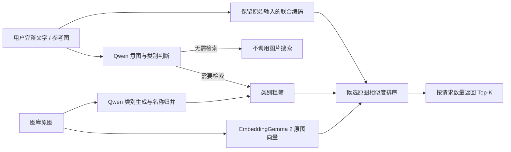

# 图搜图 / 文搜图：拍立淘式商品搜索与私有图库检索

[](https://github.com/liangjianshu/multimodal-image-retrieval/actions/workflows/tests.yml)
[](LICENSE)

[在线演示](https://liangjianshu.github.io/multimodal-image-retrieval/) · [English overview](README.en.md) · [使用反馈 / Issues](https://github.com/liangjianshu/multimodal-image-retrieval/issues) · [参与贡献](CONTRIBUTING.md)

**给一张图，找相似商品；写一句话，搜自己的图片库。**

Visual Product Search · Text-to-Image Search · Multimodal Retrieval

**也适合个人学习多模态与 Agent 应用相关技术栈**：从图文编码、意图解析、检索流程和模型调用入手，进一步实践 LoRA / SFT 微调与效果评测。

面向**电商商品搜索、图片素材库、设计参考图和企业图片资料检索**，支持中文文搜图、参考图搜图和图文融合查询。将自己的图片及元数据接入后，即可建立独立图库并运行检索；另提供 Qwen 语义建库分支的 LoRA / SFT 微调实践。

“拍立淘式”指上传参考图寻找相似商品的应用场景。本项目是个人实践，未与淘宝或阿里建立关联，也不代表其线上技术实现。拍立淘的公开场景介绍见 [阿里云官方说明](https://www.alibabacloud.com/help/en/image-search/product-overview/scenarios)。

**快速入口：** [真实效果演示](docs/DEMO.md) · [换成自己的数据](docs/CUSTOM_DATA.md) · [领域微调](docs/TRAINING.md) · [实验与效果记录](docs/EXPERIMENTS.md)

## 先看真实检索效果

[](https://liangjianshu.github.io/multimodal-image-retrieval/)

演示图库包含 **12 张 CC0 实拍图片**，覆盖椅凳、杯子和自行车。当前采用 **微调 Qwen 意图识别与类别粗筛 + EmbeddingGemma 2 原图排序**：先判断要不要检索，再确定候选类别，最后用完整文字和参考图匹配原图向量。

- **直接体验**：[在线演示](https://liangjianshu.github.io/multimodal-image-retrieval/)，包含文字、图片、图文、非检索请求和明确返回数量的真实记录。
- **离线查看**：浏览器打开 `docs/demo/index.html`，图片已内嵌，可单独复制。页面回放实测结果，不在浏览器中运行模型。
- **自己复跑**：[演示指南](docs/DEMO.md) 提供环境、权重校验、意图输出、类别归并和结果。公开基座可独立跑通流程；复现展示中的微调版本需要作者原 LoRA，权重未随仓库分发。

Qwen 为图库生成类别，并归并同义、上下位和相近用途的名称；每条查询都经过 Qwen，非检索请求会直接停止。类别及归并结果参与粗筛，详细图片说明仅供阅读。EmbeddingGemma 2 使用完整原文和参考图像素，不用 Qwen 摘要覆盖用户输入。

展示默认**不设置分数阈值**：先按 Qwen 类别粗筛，再按相似度展示已记录的 Top-K，用户明确要求两张时显示两张。相似度用于排序，不用未经校准的固定分数删除结果；没有相关类别、候选不足或非检索请求仍会少返回或不返回。

保留 [纯 Embedding 基线](docs/DEMO_EMBEDDING_ONLY.md) 与 [历史 Qwen / Taiyi-CLIP 流程](docs/DEMO_TAIYI_CLIP.md)。小图库演示不证明通用准确率或微调收益；同一基座切换适配器的独立对照仍需单独开展。完整输入被保留也不保证所有细粒度条件都被满足。

## 可以用在哪些场景

| 应用场景 | 用户怎么搜 | 接入自己的什么数据 |
| --- | --- | --- |
| **电商图搜商品 / 相似款发现** | 上传一张椅子或鞋子的图片，找外观相近的款式 | 商品图片、商品 ID、类别和属性描述 |
| **文字搜商品** | “红色木质椅子”“白色陶瓷咖啡杯” | 商品图片、类别与可见属性；商品标题可整理进描述 |
| **图片素材库 / 设计参考图检索** | “客厅里的红色沙发”，或上传参考图寻找相似素材 | 摄影图库、设计素材、家居参考图及描述 |
| **企业私有图片资料库** | 用自然语言找产品展示图、样品图和历史素材 | 自有图片目录及人工整理的类别/描述 |
| **业务数据库中的图片资产检索** | 先找到图片，再按结果 ID 查看对应商品或业务记录 | 将数据库里的图片 ID、文件路径和描述导出为 JSONL；结果按 ID 回查 |

这些是可适配的应用方向，当前提供命令行检索原型。找“视觉相似款”与严格识别“同品牌、同型号的同款”需要不同的数据和评测，后者尚未在本项目中验证。数据库场景采用**导出图片清单 → 检索 → 按 ID 关联业务记录**的接入方式，原生数据库连接器与业务界面需要自行集成。

## 为什么用这个项目验证你的图库

- **先接数据，再决定是否训练**：支持类别文件夹和 JSONL 清单，已有图片库可先建立检索基线。
- **图片与文字都能查**：支持纯文本、参考图，以及参考图加文字描述的融合查询。
- **类别和图片向量离线建库**：Qwen 生成类别并统一名称，EmbeddingGemma 2 编码原图；查询时不必重新处理整库。
- **训练和评测入口齐全**：可构造易混淆类别问答，对比微调范围，并通过自有查询集检查效果。
- **默认在本机处理图片**：图片由运行机器上的模型处理；首次使用需下载模型权重。

本项目整理自个人多模态检索实验。当前默认将 Qwen 意图/类别判断与 EmbeddingGemma 2 原图编码组合，另保留纯 Embedding 基线、Taiyi-CLIP 历史流程和 Qwen 领域 SFT。

`mmretrieval/` 是统一运行入口；`legacy/` 保存经过凭据和个人路径清理的历史源码，供追溯实验设计。**模型权重、原始 COCO / ImageNet 图片、个人训练数据与大型向量文件没有上传。**

## 能做什么

| 能力 | 作用 |
| --- | --- |
| 文搜图、图搜图、图文融合查询 | 中文描述、参考图或两者结合，返回图片 ID、路径与相似度 |
| 离线建库 | Qwen 生成类别及其归并关系，EmbeddingGemma 2 直接编码图片 |
| 原生图文联合编码 | 文字与参考图在一次前向计算中生成查询向量，不使用 50/50 平均 |
| 意图识别与类别粗筛 | 非图片检索请求不调用编码器；检索请求按模型选择的类别限定候选 |
| 方案对照 | `embeddinggemma2` 为纯原图检索，`taiyi-clip` 为历史两阶段流程 |
| 可替换数据与模型 | 图片清单、模型 ID / 本地路径、LoRA 适配器和阈值均可配置 |
| 可选 Qwen 领域训练 | 对比语言侧 LoRA、MLP＋LLM、MLP＋Vision；保存训练范围与参数量 |

检索目前使用 **NumPy 内存向量矩阵**，没有接入独立向量数据库，也没有跨编码器精排模型。大规模索引、在线服务、权限管理与并发调度需要进一步开发。

## 流程



## 1. 安装和无需模型的检查

Python 3.10+。真实模型已在单张 Ascend 910B2 验证；其他硬件请安装匹配的 PyTorch。CPU 可运行数据处理和流程测试，推理速度需要实测。

```bash
git clone https://github.com/liangjianshu/multimodal-image-retrieval.git
cd multimodal-image-retrieval
python -m venv .venv
source .venv/bin/activate
pip install -e .
python -m mmretrieval demo --output artifacts/demo
```

`demo` 会生成六张几何图片，并完成清单校验、索引保存/加载、检索和训练集划分。它使用**预设的合成向量**，只检查程序连接是否正常，不下载模型，也不代表模型检索效果。

运行默认的 Qwen + EmbeddingGemma 2 链路：

```bash
pip install -e '.[hybrid]'
```

`hybrid` 使用 Transformers **5.22.1**、Sentence Transformers **6.2.0**、PEFT **0.20.0** 与 qwen-vl-utils **0.0.14**。两种模型可在同一推理环境中运行，本次已验证作者原 7B LoRA。EmbeddingGemma 2 只加载文字和视觉模块，使用 BF16 或 FP32。

先按硬件安装匹配的 PyTorch。Ascend 用户需保留匹配 CANN 的 torch / torch_npu，再单独安装其他依赖，避免 pip 替换厂商版本。

仅运行纯 Embedding 基线可安装 `.[gemma]` 并使用 `configs/embeddinggemma2.json`。历史 Qwen 训练和 Taiyi-CLIP 流程使用**另一个虚拟环境**安装 `.[models]`（Transformers 4.57.1）；不要与 `hybrid` 混装。`prepare` / `validate` / `make-sft` 不加载模型。

## 2. 换成自己的数据（从这里开始）

不需要沿用 COCO / ImageNet。准备你有权使用的图片，可以按类别分文件夹：

```text
data/images/
├── chair/001.jpg
├── chair/002.jpg
├── sofa/001.jpg
└── cup/001.jpg
```

```bash
python -m mmretrieval prepare \
  --image-root data/images \
  --category-map examples/category_map.json \
  --output data/catalog.jsonl

python -m mmretrieval validate \
  --manifest data/catalog.jsonl --image-root data/images
```

`category_map.json` 把目录名映射为中文标签，不限制类别数量；换业务时直接修改。也可以不传映射，保留目录名。平铺目录同样可以使用；类别和描述可以留空，默认建库会调用 Qwen 生成预测字段。

你也可以直接生成 JSONL，一行一张图：

```json
{"id":"chair-001","file_path":"chair/001.jpg","categories":["椅子"],"description":"一把红色木质椅子"}
```

- `id`：唯一且稳定的字符串，用于评测关联。
- `file_path`：相对 `--image-root` 的路径，不能使用旧服务器绝对路径。
- `categories`：人工标签；原始清单中可以为空，默认建库会生成独立预测字段；训练前必须核对人工标签。
- `description`：可选展示信息；当前原图排序不使用这个字段。

图片不会被上传到外部 API；默认模型在运行机器上推理，首次使用会从模型托管平台下载权重。完整字段、数据替换清单与 COCO 导入示例见 **[自有数据指南](docs/CUSTOM_DATA.md)**。

## 3. 类别与原图向量一起建库

```bash
python -m mmretrieval --config configs/default.json index \
  --manifest data/catalog.jsonl --image-root data/images \
  --output artifacts/index-hybrid
```

默认 `index` 会依次执行 Qwen 类别/描述生成、类别名称归并、EmbeddingGemma 2 原图编码，无需先单独运行 `describe`。每张原图对应一个归一化的 768 维向量。类别用于粗筛，详细描述不参与最终相似度计算；人工 `categories` 仍用于训练/评测标注，不替代 Qwen 预测。

索引包含 `catalog.jsonl`、`features.npz` 和 `metadata.json`，记录编码器版本、权重哈希、维度、图像预算，以及 Qwen 类别来源与归并关系。默认配置使用公开 Qwen 基座；有自己的适配器时设置 `adapter`，并重新建库。

更换图片、Qwen 权重/提示词或 Embedding 模型配置后需重建索引。旧 Taiyi/CLIP 向量同为 768 维也不能混用。当前尚无增量更新命令。

## 4. 检索

```bash
# 中文文搜图
python -m mmretrieval search --index artifacts/index-hybrid --image-root data/images \
  --text '红色木质椅子' --top-k 5

# 图搜图；参考图如果在库中，会排除它自己
python -m mmretrieval search --index artifacts/index-hybrid --image-root data/images \
  --image chair/001.jpg --top-k 5

# 图文融合查询
python -m mmretrieval search --index artifacts/index-hybrid --image-root data/images \
  --image chair/001.jpg --text '类似款式的红色椅子' --top-k 5

# 返回超过固定阈值的全部结果；阈值应在验证集上选择
python -m mmretrieval search --index artifacts/index-hybrid --image-root data/images \
  --text '红色椅子' --all-matches --min-score 0.25
```

结果以 JSON 返回，可被后端或界面读取。`score` 是余弦相似度，不是概率。默认每条查询先调用 Qwen。非检索请求返回 `status=not_retrieval` 且不调用编码器；检索请求按类别筛选，排除参考图自身后排序。用户明确要求的返回数量会被识别，不需加 `--intent`。类别不明确或跨品类请求允许全库查找；明确目标无相关类别时返回空结果。不要把其他模型的阈值直接沿用到新编码器。图文输入是原生联合编码，文字与参考图冲突时的优先级仍需评测。

## 5. 模型和配置

`--config` 必须放在子命令之前，默认配置与 `configs/qwen-gemma2.json` 相同：

| 配置项 | 含义 |
| --- | --- |
| `backend` | 默认 `qwen-gemma2`；纯原图基线 `embeddinggemma2`；历史流程 `taiyi-clip` |
| `vl_model` / `adapter` | Qwen 基座与可选 LoRA；默认基座 7B，adapter 为空 |
| `prompt_profile` / `intent_profile` | 默认原类别描述提示词 `historical` 与完整条件意图提示词 `preserve` |
| `embedding_model` / `embedding_revision` | 官方模型 ID 与固定版本 |
| `embedding_model_path` | 可选本地完整权重目录；官方版本会校验权重 SHA-256 |
| `embedding_dimension` | 默认 768；也支持 512、256、128，修改后重建索引 |
| `vision_tokens` | 每张图的 token 预算，默认 280；70 / 140 / 560 / 1120 可另做对照 |
| `embedding_batch_size` | 图库编码批量，默认 4 |
| `device` | `auto`（CUDA 优先，否则 CPU）、`cuda:0`、`cpu` 或显式 `npu:0` |

Qwen 先判断意图和类别，但完整文字仍直接交给编码器，图片仍直接编码像素；摘要不会覆盖用户条件。单个查询超出 8192 token 预算时明确报错，避免静默丢失条件。768 维共享空间来自同一模型的训练，与两端是否有同一词表无关。

保留的 `configs/taiyi-clip.json` 支持 Qwen `vl_model` / `adapter`、`category_ratio`、`image_weight` 等旧参数，使用独立模型环境和独立索引目录。旧流程的运行命令见 [历史指南](docs/DEMO_TAIYI_CLIP.md)。

## 6. 领域微调

如果只想接入自己的图片库，**不必先微调**。以下训练针对历史 Qwen 语义建库分支，使用独立 `.[models]` 环境；不是 EmbeddingGemma 2 的微调接口，也不会直接更新新编码器。

```bash
python -m mmretrieval make-sft \
  --manifest data/catalog.jsonl --image-root data/images \
  --hard-negatives examples/hard_negatives.json \
  --output data/sft --val-ratio 0.2 --seed 42

python -m mmretrieval --config configs/taiyi-clip.json train \
  --train data/sft/train.jsonl --val data/sft/val.jsonl \
  --image-root data/images --output checkpoints/mlp-llm \
  --mode mlp-llm --rank 64 --alpha 128 --epochs 0.5 --grad-accum 4
```

MLP 指视觉连接模块 `visual.merger`，不是所有 Transformer MLP。`mlp-llm` 对语言注意力做 LoRA，同时训练并保存 merger。每设备 batch size 为 1，通过梯度累积扩大有效 batch。

**难负例仍必须给出正确答案**：例如杯子图被问“主要物体是碗吗”，目标答案应为“否”。本项目构造的是监督问答难例，不是 InfoNCE 对比学习。生成问答前按图片内容哈希划分训练/验证，避免同图不同问法泄漏。

三种训练范围、适配器加载、完整视觉微调模型加载与注意事项见 **[训练指南](docs/TRAINING.md)**。

## 7. 评测

编写与当前图片 ID 对齐的查询集，格式见 `examples/queries.jsonl`，然后：

```bash
python -m mmretrieval evaluate --index artifacts/index-hybrid --image-root data/images \
  --queries data/queries.test.jsonl --top-k 5 --output artifacts/evaluation.json
```

报告包含逐查询 Precision / Recall / F1 和宏平均。对比时固定图库、查询、相关性标注、参考图排除规则及返回阈值；不要用测试集选阈值。使用人工类别建立索引和使用模型预测类别建立索引是不同设置，应分别报告。

历史实验记录中的文搜图 / 图搜图 F1 **+6 / +7 个百分点**来自作者原实验记录，**本次整理未重新复现，不是此仓库在任意数据上的保证**。新版数据处理、评测与保存逻辑有改动，不能直接继承历史分数。详情见 [实验记录与复现边界](docs/EXPERIMENTS.md)。

## 目录与开发

```text
mmretrieval/     意图/类别路由、原图联合编码、索引、历史检索、Qwen SFT 和 CLI
configs/        模型与检索配置
examples/       清单、查询与难负类别映射；showcase/ 含 12 张 CC0 演示图片
tests/          数据与检索测试、微型随机 Qwen 训练/保存测试
docs/           自有数据、训练、实验记录与整理说明
legacy/         清理后的历史实验源码和对应第三方许可证
```

```bash
pip install -e '.[dev]'
pytest -q
```

安装 `.[models,dev]` 后还会执行微型随机 Qwen 的参数范围、一次训练更新和保存/恢复测试；测试不下载预训练权重。大模型真实效果与 GPU 吞吐需要单独实测。

## 来源与许可

项目代码采用 [MIT License](LICENSE)，另有许可证声明的第三方文件除外。`legacy/project_three/Qwen3-VL/` 下的 Qwen 源码继续遵循其 Apache-2.0 许可证，详见 [第三方说明](THIRD_PARTY_NOTICES.md)。演示照片采用 CC0，作者与原始链接见 [图片来源](examples/showcase/SOURCES.md)。来源和整理范围见 [PROVENANCE](docs/PROVENANCE.md)。依赖和模型分别遵循自身许可，原 COCO / ImageNet 数据集请从官方渠道获取。

- [EmbeddingGemma 2](https://huggingface.co/google/embeddinggemma-2) / [官方多模态使用说明](https://ai.google.dev/gemma/docs/embeddinggemma/multimodal-embeddinggemma-with-sentence-transformers)
- [Qwen2.5-VL 模型](https://huggingface.co/Qwen/Qwen2.5-VL-7B-Instruct) / [官方代码与训练接口](https://github.com/QwenLM/Qwen3-VL)
- [Taiyi-CLIP 中文文本编码器](https://huggingface.co/IDEA-CCNL/Taiyi-CLIP-Roberta-large-326M-Chinese) / [CLIP ViT-L/14](https://huggingface.co/openai/clip-vit-large-patch14)
- [PEFT](https://github.com/huggingface/peft) / [COCO](https://cocodataset.org/) / [ImageNet](https://www.image-net.org/)

## 反馈与参与

欢迎通过 [Issue](https://github.com/liangjianshu/multimodal-image-retrieval/issues/new/choose) 分享你的接入场景、复现问题或改进建议；提交时请说明环境和最小复现步骤。贡献方式见 [CONTRIBUTING](CONTRIBUTING.md)。如果项目对你学习或接入自己的图库有帮助，欢迎 Star 收藏。
