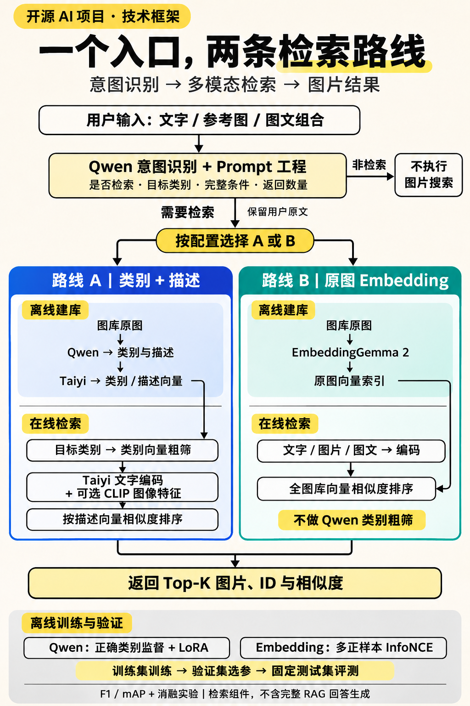

# 技术架构：共享意图入口，两条独立检索路线

本项目回答一个具体问题：如何把文字、参考图片或图文组合请求，转换成图片库里的相关结果？当前实现覆盖意图解析、离线建库、在线检索，以及两类模型训练和评测；尚未实现完整的 RAG 回答生成或 Agent 工具编排。

[运行指南](QUICKSTART.md) · [训练与学习路线](LEARNING_PATH.md) · [第三、四页分享图与 PDF](social/README.md)



[下载框架图](assets/retrieval-architecture.png) · [可编辑 Mermaid 源码](assets/retrieval-architecture.mmd)

这张图是根据当前代码整理的流程概览，采用 AI 辅助排版并人工核对；不是模型运行截图。图中的 A/B 是配置选择的替代路线，不是先执行 A 再执行 B，也不是自动合并两者结果。图按逻辑阶段排布；实际代码可能先编码查询，再筛选和排序。

## 1. 一次查询经过哪些步骤

入口为 [`RoutedRetriever.search`](../mmretrieval/routes.py)。默认路线 A 使用 `qwen-semantic`，路线 B 使用 `qwen-embedding`。

1. 接收文字、图片，或二者的组合，拒绝空请求。
2. 调用 Qwen 解析请求，判断是否需要图片检索。
3. 对非检索请求返回 `status=not_retrieval` 和空结果；当前接口不继续生成知识问答答案。
4. 对检索请求，按配置选择 A 或 B，并保留用户原文参与编码。
5. 在各自索引中检索，排除指定 ID；CLI 会排除同一路径的参考图片自身。
6. 根据请求数量或默认 `top_k` 返回图片元数据与余弦相似度，同时记录阶段耗时。

示例：用户说“找三张有两只猫的图片”，`top_k` 应为 3，“两只猫”属于内容条件。用户说“只描述这张图，不要找其他图片”，则不进入图片检索。字段示例用于说明接口，不代表新增实测。

## 2. Qwen 意图识别与 Prompt 工程

当前双路线使用 [`ROUTE_INTENT_PROMPT`](../mmretrieval/intent.py)，结构化字段包括：

| 字段 | 用途 |
|---|---|
| `needs_retrieval` | 是否进入图片检索，非检索请求提前返回 |
| `target_category` | 路线 A 的类别查询；路线 B 不使用它筛选图库 |
| `description` | 目标描述，路线 A 的纯图片请求可用它形成文字查询 |
| `constraints` | 保存明确提出的颜色、场景、否定等条件，供查看和诊断 |
| `top_k` | 用户明确要求的返回数量；未指定时使用调用方默认值 |

有用户文字时不使用模型摘要覆盖原文。例如“草地上的自行车”不能简化成“自行车”；参考图的蓝色墙面也不能覆盖文字中的草地要求。路线 B 将原文与参考图直接交给多模态编码器；路线 A 先编码原文，再可选融合 CLIP 参考图特征。

`constraints` 当前不是逐条硬约束过滤器。保留了条件，并不保证模型准确理解否定、颜色或精细属性。只有图片的查询也经过 Qwen 意图入口。更多提示词规则和历史差异见 [Prompt 与编码说明](INTENT_AND_EMBEDDINGS.md)。

## 3. 路线 A：Qwen 类别与描述

### 离线建库

`execute_route(index)` 读取图片清单，再对每张图片执行：

```text
原图 → Qwen 生成类别和描述
     → Taiyi 编码类别文字、描述文字
     → 保存独立的类别向量与描述向量
```

代码同时保存 CLIP 原图特征，但当前 `qwen-semantic` 路线最终候选打分使用的是**描述向量**，不能把它写成“候选原图直接检索”。Qwen 预测保存在 `retrieval_categories` / `retrieval_description`，不覆盖用于监督或评测的人工标签。

### 在线粗筛与排序

- 目标类别通过 Taiyi 编码，与图库类别向量计算相似度，按相对阈值保留候选。
- 完整用户文字通过 Taiyi 编码；纯图片请求使用 Qwen 的目标描述。若存在参考图，还可融合 CLIP 图像向量并归一化。
- 对候选的描述向量计算相似度，排序后返回结果。

这里的“类别粗筛”是**类别文字向量的相似度筛选**，不是精确类别相等判断，也不是 Qwen 逐一评审候选。描述排序没有额外的 cross-encoder 或 LLM 精排器。相关实现见 [`routes.py`](../mmretrieval/routes.py)、[`retrieval.py`](../mmretrieval/retrieval.py) 与 [`models.py`](../mmretrieval/models.py)。

Taiyi 中文文本编码器和配套 CLIP 视觉编码器用于共享向量空间中的融合；文本词表并不需要与图像 patch 一一对应。维度相同本身不能证明任意两个模型的向量可以混用。

### 能力与限制

这条路线保留可读的中间类别和描述，方便定位问题、分析 Qwen 微调的作用。但候选图片先被转成文字，会丢失描述未覆盖的纹理、局部结构等信息。粗筛错误还可能使正确图片在排序前就被排除。

## 4. 路线 B：直接学习多模态检索向量

### 离线建库

```text
原图像素 → EmbeddingGemma 2 → 归一化图像向量 → 独立图片索引
```

此路线建库不依赖 Qwen 类别或描述。当前配置采用 768 维向量，具体模型版本、视觉 token 配置和权重校验见 [`gemma.py`](../mmretrieval/gemma.py)。

### 在线检索

共同的 Qwen 意图入口判断是否检索后，编码器根据输入处理纯文字、纯图片或图文联合查询，再与图库图像向量计算余弦相似度。**原图索引参与排序，不参与查询编码；此路线不做 Qwen 类别粗筛。**

实际索引为本地 JSONL、NumPy 向量与元数据文件，使用矩阵计算和排序；尚未接入 Milvus、FAISS 或其他大规模近似最近邻检索服务。实现见 [`ImageIndex`](../mmretrieval/image_index.py)。

模型、预处理与向量空间必须一致。代码校验索引指纹；改编码器或使用微调权重后应重新建库，不能直接复用旧向量。相似度不是正确概率，全图库检索也不保证颜色、材质或同款约束一定满足。

## 5. 两种训练分别改变什么

| | Qwen SFT / LoRA | Embedding 对比学习 |
|---|---|---|
| 训练目标 | 根据图片输出正确类别 JSON | 拉近相关查询与图片，拉远不相关样本 |
| 监督 | 正确类别答案；困难样本也必须保留正确目标 | 文图、图图正负关系，同类批内样本作为多正例 |
| 损失/方法 | 监督微调、语言侧 LoRA，并对照连接层联合训练 | 多正样本 InfoNCE，全参数微调 |
| 影响环节 | 类别输出及其格式适配，进而影响路线 A 的筛选 | 查询与图库向量空间，影响路线 B 排序 |
| 当前最佳验证配置 | `lr=1e-5, epoch=1, rank=64, alpha=128`，LLM LoRA | `lr=2e-6, temperature=0.1, epoch=1` |

当前类别 SFT 的训练收益不能直接说成“描述能力提升”；也不能说意图识别历史成绩是本轮类别训练带来的。类别相关性的对比学习同样不等于学习了细粒度商品身份或属性约束。

历史保留数据中曾发现将错误类别写成 SFT 标准答案的生成逻辑。支持的训练入口要求监督答案正确；具体复核结论见 [实验记录](EXPERIMENTS.md)，不要将历史错误标签称为有效困难负例方法。

[Qwen 训练指南](TRAINING.md) · [Embedding 训练指南](EMBEDDING_TRAINING.md) · [正式实验协议](RESTORED_STUDY.md)

## 6. 为什么不能只展示最大的提升数字

正式实验使用 4,500 张训练图、1,000 张验证图与 2,000 张测试图库，共 8 组配置、24 个验证检查点。模型与阈值在验证集选定。主表展示五个重点类别的平均检索 F1，候选图库包含全部 15 类；完整报告同时保留 mAP。

| 对照口径 | 基座文搜图 F1 | 微调文搜图 F1 | 基座图搜图 F1 | 微调图搜图 F1 |
|---|---:|---:|---:|---:|
| Qwen：统一 JSON 结构归一化后的补充诊断 | 76.07% | 86.76% | 63.90% | 81.86% |
| Embedding：原始固定协议 | 61.68% | 88.84% | 31.85% | 83.40% |

Qwen 原始严格协议还包含明显的格式解析差异。统一结构归一化后，收益仍为 +10.69 / +17.96 个百分点，但不能全部归因于纯视觉能力。共用类别筛选、只替换描述向量时，文搜图/图搜图差值为 +2.48 / +0.01 个百分点：该任务下的主要收益集中在类别筛选。

归一化和组件消融是查看固定实验结果后的补充诊断，复用已存输出，并各自在验证集校准阈值；不是新的盲测，不替换原始协议。两行对照应分别解读，不能把两种增益当成完全相同设置下的算法排名。

当前只有单随机种子结果；相关性按类别定义，不证明颜色、材质、同款或跨域效果。12 张展示图库只用于演示流程，与正式测试集分开。[完整归因与结果源文件](QWEN_CONTROLS.md)。

## 7. 与 RAG、Agent 的关系

本项目可以作为检索工具：输入请求，输出图片 ID、元数据与相似度。要组成完整多模态 RAG，还需要证据组织、回答生成、来源引用和答案评测；要组成完整 Agent，还需要工具接口、调用编排、异常处理等。当前没有实现这些完整系统，不把未来接入方向标成现有功能。

## 8. 从源码继续看

| 模块 | 入口 |
|---|---|
| CLI 与配置分派 | [`cli.py`](../mmretrieval/cli.py) |
| A/B 路线、共同意图入口、计时与返回值 | [`routes.py`](../mmretrieval/routes.py) |
| 任务提示词与条件保留 | [`intent.py`](../mmretrieval/intent.py) |
| Qwen、Taiyi、CLIP 加载与调用 | [`models.py`](../mmretrieval/models.py) |
| 多模态编码与模型指纹 | [`gemma.py`](../mmretrieval/gemma.py) |
| 路线 B 索引、排除与排序 | [`image_index.py`](../mmretrieval/image_index.py) |
| 正式训练/评测脚本 | [`examples/training/`](../examples/training/) |

第一次体验建议从 [快速开始](QUICKSTART.md) 入手。公开配置加载基座，作者微调权重尚未分发；本地静态页面只是已记录结果的回放。真实模型推理需要另行准备模型运行环境。
