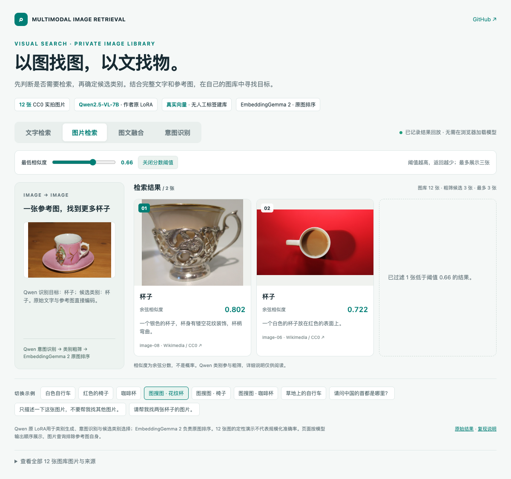
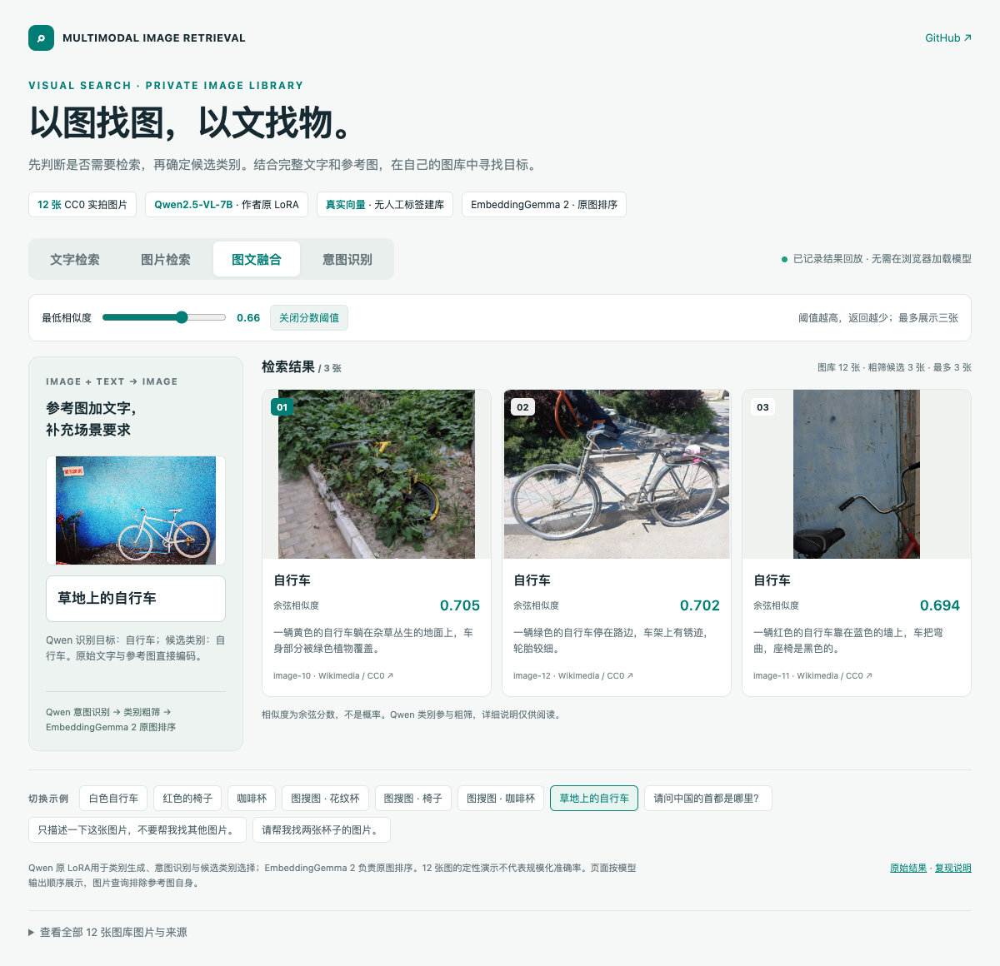
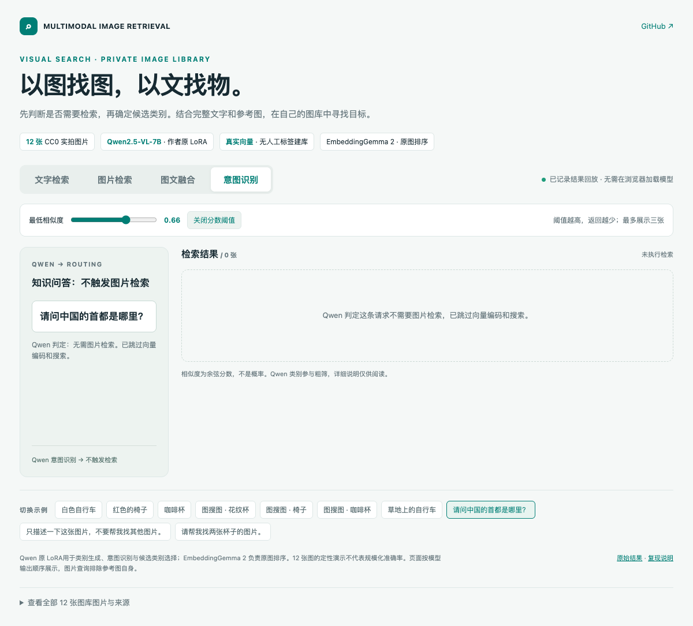

# 微调 Qwen 意图识别、类别粗筛与原图检索

[在线演示](https://liangjianshu.github.io/multimodal-image-retrieval/) · [完整结果](demo/results.json) · [Qwen 意图输出](demo/intents.json) · [类别归并](demo/category-groups.json)

当前展示在 12 张 CC0 图片上重新运行 10 条请求：原来的 7 组检索、2 条非检索请求，以及 1 条明确要求返回两张的请求。结果由实际模型运行生成，没有手工调整排名。线上与离线 HTML 都是交互回放，不是实时模型服务。





## 模型各自负责什么

| 阶段 | 执行者与作用 |
| --- | --- |
| 图库类别与描述 | Qwen2.5-VL-7B + 作者原 LoRA，使用原类别/描述提示词 |
| 类别名称归并 | 同一 Qwen 把原类别映射到代表类别，完整映射落盘 |
| 是否需要检索、目标类别、条件、数量 | 每条请求调用同一微调 Qwen，包括纯图片和非检索请求 |
| 类别粗筛 | 代码根据 Qwen 识别/选择的类别和其生成的归并关系筛选候选 |
| 原图排序 | EmbeddingGemma 2 编码完整用户文字、参考图及图库原图，比较余弦相似度 |
| 展示阈值 | 所有示例统一使用 0.66，可调节或关闭，不修改原始分数 |

Qwen 的类别判断实际影响候选，原训练模型不再只提供图片说明。详细描述仅供阅读，不能覆盖用户原文；图文联合编码不使用 50/50 向量平均。只有图片时仍编码原图像素，不把它转换成描述来替代。

旧版采用类别向量相对阈值粗筛；本版采用显式类别组过滤，再进行原图排序。两种粗筛实现不同，旧的 `category_ratio` 只用于历史 `taiyi-clip` 分支。

## 路由与类别处理

- `needs_retrieval=false` 时，直接返回 `status=not_retrieval`；该请求不做 Gemma 查询编码或索引搜索。CLI 中 Gemma 按需加载，已有服务实例也不会为这条请求执行编码。
- 类别明确时选择对应候选；名称粒度不同先按 Qwen 生成的映射归并。本次把“茶杯”归为“杯子”，把“椅子”与“凳子”保留为不同类别。没有人工按图片编号过滤结果。
- 类别不明确、需要跨品类时允许 `all`；明确目标但图库无相关类别时返回空结果。
- 若模型省略额外的路由字段，但它识别的目标类别或其已知别名能精确匹配图库，则代码补全相应类别筛选。非检索请求的类别选择字段统一清空。无法补全的字段或不存在的候选类别会报错，不默认启动无条件检索。
- 无文字参考图的可见属性不作为用户明确约束；`constraints` 置空。原始模型字段保存在 `raw_response`，可以区分模型输出与代码补全。
- 数量由 Qwen 识别，`top_k=2` 时原始检索最多返回两张；展示分数阈值仍可能进一步减少数量。

提示词见 [intent.py](../mmretrieval/intent.py)，公共执行逻辑见 [hybrid.py](../mmretrieval/hybrid.py)。

## 实测记录

| 请求 | Qwen 结果 / 类别范围 | 候选数 | 原始返回 ID | 含意图处理耗时 |
| --- | --- | ---: | --- | ---: |
| 白色自行车 | 自行车 | 4 | image-09, image-12, image-10 | 3.11 s |
| 红色的椅子 | 椅子 | 3 | image-03, image-04, image-02 | 2.78 s |
| 咖啡杯 | 杯子 | 4 | image-07, image-08, image-06 | 2.59 s |
| 一张参考图，找到更多杯子 | 杯子 | 3 | image-08, image-06, image-05 | 2.73 s |
| 给一张椅子图，找相似素材 | 椅子 | 2 | image-03, image-04 | 4.52 s |
| 用咖啡杯照片找相似图片 | 杯子 | 3 | image-07, image-08, image-05 | 2.67 s |
| 草地上的自行车 | 自行车 | 3 | image-10, image-12, image-11 | 2.50 s |
| 请问中国的首都是哪里？ | 不需要检索 | 0 | — | 1.37 s |
| 只描述一下这张图片，不要帮我找其他图片。 | 不需要检索 | 0 | — | 3.40 s |
| 请帮我找两张杯子的图片。 | 杯子 | 4 | image-07, image-08 | 2.54 s |

知识问答“请问中国的首都是哪里？”以及带图的“只描述一下这张图片，不要帮我找其他图片”均判为无需检索。明确的“两张”要求被识别为 `top_k=2`。这三条固定检查通过，不等同于通用意图分类准确率。

本次检索请求耗时约 **2.50–4.52 秒**，包含 Qwen 生成、查询编码与候选排序，不含模型初始化；每条只测一次，不是重复性能基准。此前约 90–187 ms 是纯 Embedding 编码耗时，不能当作当前完整链路延迟。

最终运行 Qwen 初始化 19.21 秒，Gemma 初始化 13.55 秒，类别归并 7.46 秒，12 张原图批量编码 1.62 秒。首次本轮运行重新生成了 12 张图库的类别/描述；修正路由后复用了这次同模型、同提示词的描述产物，再执行类别归并、全部查询和原图建库。最终 JSON 中 `descriptions_reused=true`，`description_seconds` 是缓存读取时间，不是描述生成速度。

## 结果与边界

花纹杯查询原始三张结果为银色花纹杯、咖啡杯、保温杯；先前纯 Embedding 的第三张椅子已被类别筛选排除。因此即使关闭展示分数阈值，也不会在这一组返回椅子。

类别筛选并非只有收益。“红色椅子”查询排除了红色凳子，剩余候选虽然属于椅子类，但不满足红色要求；当前没有逐条颜色硬校验。更严格的类目范围可能漏掉用户愿意接受的相似物品，需要按业务定义类别边界。

默认 0.66 展示阈值沿用前一版。自然语言请求“请帮我找两张杯子的图片。”的原始两个分数低于 0.66，因此默认展示可能为空；关闭分数阈值可看到两个实际结果。这也说明短词与完整自然语言的分数分布不同，展示阈值尚未独立校准，不应直接用于生产。

本次未重新训练任何模型，没有证明“微调相比同一基座带来多少收益”。[纯 Embedding 基线](demo/baseline-embeddinggemma2/results.json) 与 [历史 Taiyi/CLIP 结果](demo/baseline-taiyi-clip/results.json) 均保留。严格衡量微调贡献仍需固定同一基座、数据和流程，只切换适配器进行对照。

## 权重与环境

- Qwen2.5-VL-7B-Instruct + 原 `output_lora_llm`：rank 64、alpha 128、语言注意力 LoRA；224 个保存张量逐项校验，112 个 LoRA B 非零且适配器启用。[校验记录](demo/adapter-verification.json)
- LoRA SHA-256：`c3c463ca6f394ab4cc7e936bcc39cc14ec09f0b5afbc9ffb635e7a37fcb6738a`。没有单独保存 merger，不能把它描述为加载了完整 MLP+LLM 产物。
- EmbeddingGemma 2 固定版本 `f9972ac22e696a105c482202646979e33e4b5a1e`，权重 SHA-256：`197a32965d4b1105faf060417baa899e193fb73cd401f42ec9295234d5553d79`。
- 单张 Ascend 910B2；BF16；PyTorch / torch_npu 2.7.1；Transformers 5.22.1；Sentence Transformers 6.2.0；PEFT 0.20.0；qwen-vl-utils 0.0.14。
- Gemma 仅加载文字与视觉模块；768 维，视觉预算 280，图库 batch 4。Qwen 最大图片像素 262144、生成上限 384，贪心生成。

## 复跑

在独立环境按 [README](../README.md) 安装 `.[hybrid]`。Ascend 保留匹配 CANN 的厂商 PyTorch/torch_npu，单独安装其余依赖。

```bash
python examples/showcase/run_hybrid.py \
  --config configs/showcase-hybrid.json \
  --adapter-path /path/to/output_lora_llm \
  --output artifacts/showcase-hybrid
python examples/showcase/build_page.py \
  --results artifacts/showcase-hybrid/results.json --output artifacts/showcase-hybrid/index.html
python examples/showcase/build_page.py \
  --results artifacts/showcase-hybrid/results.json --image-mode external --output docs/index.html
```

本地权重可用 `--qwen-path` 和 `--gemma-path` 指定，Ascend 追加 `--device npu:0`。`--reuse-descriptions` 只用于同一图库、模型和描述提示词的已完成缓存。提示词修正后应重新执行全部查询。

公开配置 `configs/qwen-gemma2.json` 的 adapter 为空，可运行同样结构的基座流程；`configs/showcase-hybrid.json` 引用作者原 LoRA，权重未随仓库分发。自己的图库直接使用默认 `index`、`search`、`evaluate`，无需额外的 `--intent` 开关。

旧流程入口：[纯 Embedding](DEMO_EMBEDDING_ONLY.md) · [Qwen / Taiyi-CLIP](DEMO_TAIYI_CLIP.md)。
