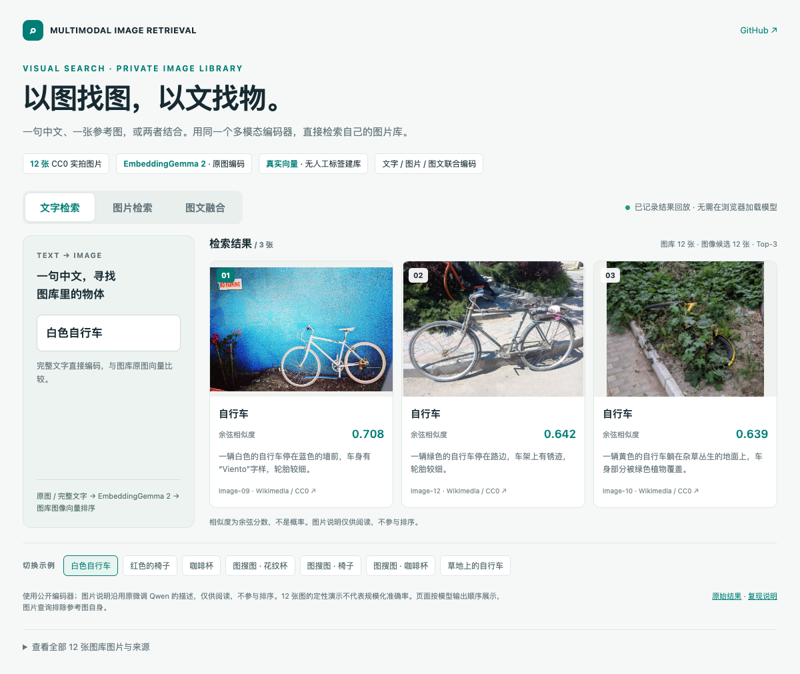
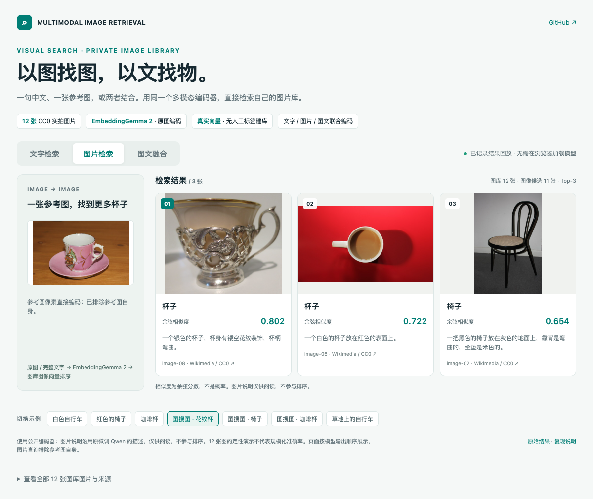
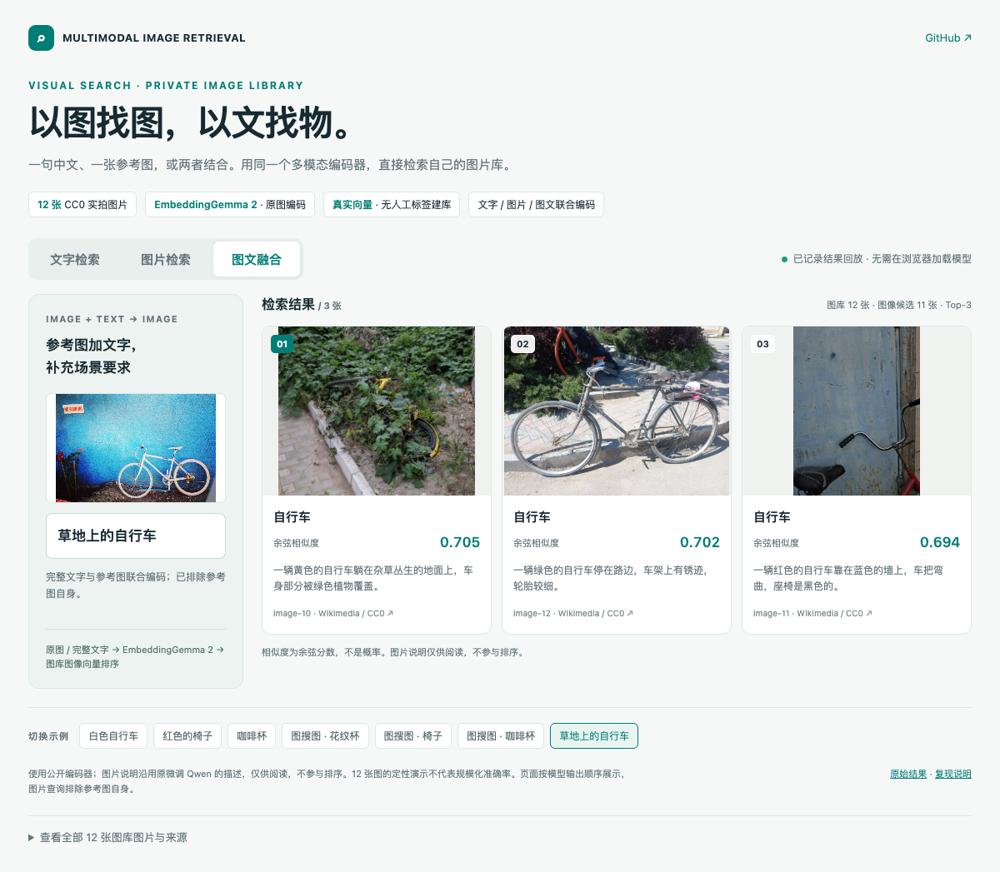

> 此页保留旧流程。当前主展示已切换 EmbeddingGemma 2，见 [新版指南](DEMO.md)。旧配置使用独立的 `.[models]` 环境。

# 历史 Qwen LoRA + Taiyi-CLIP 演示与复现

主展示使用 **Qwen2.5-VL-7B-Instruct + 作者原训练 LoRA**，在 12 张 CC0 图片上运行 7 组文字、图片和图文融合查询。展示的是实测排名，没有人工调换图片顺序。

## 直接看效果

打开 **[在线演示](https://liangjianshu.github.io/multimodal-image-retrieval/)**，或用浏览器打开 [`demo/index.html`](demo/index.html)。离线 HTML 已内嵌图片，单独复制也可查看；首屏不依赖 JavaScript，切换示例需要脚本支持。

这是已记录结果的交互回放，不是在线推理服务。所有排名、分数、模型解析的查询目标和运行配置见 [results.json](demo/baseline-taiyi-clip/results.json)。







## 模型与原项目的对应关系

- 基座为 `Qwen/Qwen2.5-VL-7B-Instruct`，加载原项目 `project_three/output_lora_llm` 适配器；它与 `project_one/output_lora_llm` 的权重 SHA-256 一致。
- 适配器实际配置为 **rank 64、alpha 128、语言注意力 q/k/v/o LoRA**。这个保存产物没有额外的 `modules_to_save`，不能据此宣称加载了单独训练的视觉 merger。
- 每个已保存 LoRA 张量与实际加载参数逐个核对，并确认 `default` 适配器处于激活状态、LoRA B 存在非零权重。见 [加载校验](demo/adapter-verification.json)。
- 类别提取和属性描述（原 `prompt2`）继续使用 [`historical_prompts.py`](../mmretrieval/historical_prompts.py) 中的原提示词；查询端改用 [`intent.py`](../mmretrieval/intent.py) 的完整条件解析，并由代码保留用户原文。历史意图提示词仍保留用于对照。

原适配器权重未随仓库分发。`configs/showcase-lora.json` 中的 `models/retrieval-lora` 是本地路径占位符；拥有该权重时可用 `--adapter-path` 指向真实目录。公开基座版本仍可独立复跑。

## 实际流程

1. 校验 12 张 Wikimedia CC0 图片的 SHA-256。人工类别与描述为空，来源见 [图片清单](../examples/showcase/SOURCES.md)。
2. 微调后的 Qwen 分别生成类别和详细描述，写入 [模型描述](demo/catalog.described.jsonl)。随后重新编码、重建索引，不复用旧 3B 模型的描述或向量。
3. Taiyi 编码类别与描述；CLIP ViT-L/14 编码图片。类别文本使用逗号拼接。
4. 对参考图查询，微调后的 Qwen 解析类别、完整目标和用户约束。有用户文字时，Taiyi 直接编码原文，模型摘要不得覆盖它；只有图片时才编码生成的目标描述。再与参考图的 CLIP 特征各占 50% 归一化融合。原始意图输出见 [intents.json](demo/baseline-taiyi-clip/intents.json)。
5. 对明确的文字短语直接编码；按类别向量粗筛（最高分的 0.85），再按描述向量余弦分数排序。最多展示前三张，排除参考图自身；不足三张时不补入被筛掉的图片。

保留原项目的微调模型、建库提示词与图像融合方法，并修复意图摘要覆盖原文的问题，**不是逐行执行历史交互脚本**：本展示固定 Top-3、不随机抽取阈值结果；文字示例已是目标短语，不调用历史脚本中的独立纯文本意图模型；分数展示为余弦相似度，不乘 CLIP 温度系数。硬件、图像尺寸上限与依赖版本也以当前配置为准。

## 自己运行

先按 [README](../README.md) 准备对应硬件依赖，在仓库根目录执行：

```bash
python examples/showcase/run.py \
  --config configs/showcase-lora.json \
  --adapter-path /path/to/output_lora_llm \
  --output artifacts/showcase-lora
```

配置选择 `prompt_profile=historical`、`intent_profile=preserve`，自动使用 [`queries-lora.json`](../examples/showcase/queries-lora.json)。不要将 7B 适配器加载到 3B 基座。模型已下载时追加 `--model-root /path/to/models`，其中应包含对应的 `qwen-vl-7b/`、`taiyi/`、`clip/`。

输出包括：

```text
artifacts/showcase-lora/
├── adapter-verification.json  # 加载权重校验
├── catalog.described.jsonl    # 模型生成的图库元数据
├── intents.json              # 每个图片查询的目标解析
├── index/                    # 图片清单、特征与索引元数据
└── results.json              # 查询、排名、分数、配置、环境
```

`--reuse-descriptions` 只用于复用同一模型、适配器和建库提示词的描述。本次仅修改查询端，复用了前次图库描述，重新执行意图解析、编码和检索；`description_seconds` 不包含生成 12 张图库描述的耗时。模型权重发生变化时使用新目录，重新生成描述和索引。

没有原适配器时，可以复跑单独的 3B 基座版本：

```bash
python examples/showcase/run.py --config configs/showcase.json --output artifacts/showcase-3b
```

它使用不同提示词，并包含纯 CLIP 对照，不等同于主展示的微调流程。

生成离线单文件或轻量网站：

```bash
python examples/showcase/build_page.py \
  --results artifacts/showcase-lora/results.json --output artifacts/showcase-lora/index.html
python examples/showcase/build_page.py \
  --results artifacts/showcase-lora/results.json --image-mode external --output docs/index.html
```

后一种模式同时复制图片到 `images/`，发布时需要一起上传。GitHub Pages 从 `main` 分支 `/docs` 发布；离线单文件位于 `docs/demo/index.html`。页面生成器只渲染已有结果，不执行检索或改变排名。

## 运行环境与可复现边界

| 项目 | 设置 |
| --- | --- |
| 硬件 | 单张 Ascend 910B2，显式 `npu:0` |
| Python | 3.11.15 |
| PyTorch / torch_npu | 2.7.1 / 2.7.1 |
| Torchvision / Transformers | 0.22.1 / 4.57.1 |
| PEFT / qwen-vl-utils | 0.20.0 / 0.0.14 |
| Qwen 精度 | bfloat16；贪心生成 |
| 输入限制 | `max_pixels=262144`、`max_new_tokens=256` |
| 视觉语言模型 | Qwen2.5-VL-7B-Instruct + 原 rank-64 LoRA |
| 文本编码器 | IDEA-CCNL/Taiyi-CLIP-Roberta-large-326M-Chinese |
| 图像编码器 | openai/clip-vit-large-patch14 |

模型文件哈希见 [model-files.json](demo/model-files.json)。不同设备、精度、处理器版本可能改变生成内容和排序。耗时未经重复测量，不作为性能基准。

Ascend 需先配置匹配 CANN 的 PyTorch 与 torch_npu，避免直接安装会替换 PyTorch 的依赖组。显式传 `--device npu:0`；`auto` 只自动选择 CUDA 或 CPU。此次验证是推理，不是 NPU 训练。

## 与先前演示的区别

原 7B 版本把“草地上的自行车”解析成“自行车”，黄色车排在第三；原始记录保存在 [修复前结果](demo/baseline-lora-intent/results.json)。当前版本修复摘要覆盖，并保留完整用户文字。新提示词和代码行为见 [条件保留说明](INTENT_AND_EMBEDDINGS.md)。原文不丢失并不保证每个属性都被排序模型正确理解，仍需要独立查询集评测。

旧版 [3B 原始结果](demo/baseline-3b/results.json) 和 [图库描述](demo/baseline-3b/catalog.described.jsonl) 原样保留。它没有加载原 LoRA，图搜图的纯 CLIP 结果中出现了椅子召回杯子、杯子召回自行车，不能作为原微调项目效果的代表。

两版同时改变了 **基座大小、适配器、提示词和图像查询流程**，因此结果差异不能单独归因于 LoRA。要衡量微调贡献，需要同一 7B 基座、相同提示词与查询流程下，仅切换适配器的独立对照。

本图库小且类别有限，不用于声称规模化准确率、同品牌同型号识别能力或历史 F1 收益复现。接入自己的数据后，按 [自有数据指南](CUSTOM_DATA.md) 重建索引，并用独立查询与相关性标注评测。
