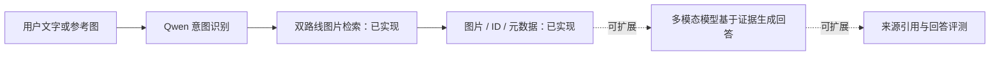

# 从看懂检索，到训练自己的多模态模型

这个项目适合已经接触 Python、想把模型调用推进到数据构建、训练和评测的人。第一次接触也可以先看网页，不需要启动模型。它是一份带源码和真实实验的实践项目，不是完整课程。

[项目介绍](https://liangjianshu.github.io/multimodal-image-retrieval/overview/) · [实际结果回放](https://liangjianshu.github.io/multimodal-image-retrieval/route-b/) · [固定图库实验](https://liangjianshu.github.io/multimodal-image-retrieval/study/)

## 你可以学到什么

| 技术 | 用通俗的话说 | 在项目里做什么 | 从哪里读起 |
|---|---|---|---|
| 多模态检索 | 用文字、图片或两者一起找图片 | 文搜图、图搜图、图文组合查询 | [两条路线](../README.md#两条检索路线共用-qwen-意图识别) |
| Qwen 意图识别 | 先判断用户是不是在找图片 | 提取目标、要求与数量；非检索请求不搜索 | [意图与向量](INTENT_AND_EMBEDDINGS.md) |
| Prompt 工程 | 把模糊请求变成明确任务和输出格式 | 设计结构化字段与示例，保留否定／修改条件，区分物体数量与返回数量 | [提示词实践](INTENT_AND_EMBEDDINGS.md#prompt-工程从自然语言到可执行查询) |
| Qwen-VL + LoRA / SFT | 教模型按任务要求输出类别 | 类别 JSON 监督微调；推理时生成可读描述并建库 | [Qwen 训练](TRAINING.md) |
| 多模态 Embedding | 把文字和原图放到可比较的向量空间 | 使用 EmbeddingGemma 2；原图直接编码与余弦排序 | [Embedding 接入与训练](EMBEDDING_TRAINING.md) |
| 对比学习 / InfoNCE | 让相关样本更靠近，让不相关样本分开 | 文图／图图训练、困难负样本、同类多正例 | [正式训练代码](../examples/training/run_embedding_trial.py)、[损失函数](../mmretrieval/study_metrics.py) |
| 实验与评测 | 判断模型是否真的变好、好在哪里 | 数据划分、验证选参、F1 / mAP、格式与类别消融 | [实验协议](RESTORED_STUDY.md)、[收益归因](QWEN_CONTROLS.md) |

## 建议的学习顺序

1. **先看结果。** 按[快速开始](QUICKSTART.md)在本地打开演示，无需 GPU 或模型安装。对比“两张杯子”“红色椅子”和非检索请求；切换基座与微调路线，理解数量控制、类别和属性的区别。页面回放已有输出，不支持自由输入实时推理。
2. **换成自己的图片。** 按[自有数据指南](CUSTOM_DATA.md)准备文件与 JSONL 清单，先用公开基座建库、检索。查看结果 ID、类别和分数，再决定改什么。
3. **分别理解两种训练。** Qwen 的 SFT 需要正确答案；错误类别不能直接作为要学习的标准答案。Embedding 的对比学习通过正负关系训练向量，同类批内样本不能误当负例。
4. **做一次可解释的对照。** 先按图片划分训练／验证／测试，再构建训练样本；在验证集选参数，在固定测试集报告 F1 与 mAP。不要用测试集挑最高分阈值。
5. **读失败案例与消融。** 看格式解析如何影响硬筛选，比较去掉类别筛选后的结果。分类召回变好，不代表颜色、材质或同款识别都变好。

## 多模态 RAG 与 Agent：如何接上去？

当前仓库实现的是**可用于多模态 RAG 的检索部分**：理解检索意图，建立图片索引，返回相关图片及 ID／元数据。它没有完成基于检索证据生成回答、引用来源、答案可靠性评测的完整 RAG 系统。

如果做 Agent，可将检索接口封装为工具供 Agent 调用；目前仓库有意图路由与检索入口，不是完整的 Agent 编排平台。数据库应用可导出图片清单，再按检索结果 ID 查询业务记录，原生数据库连接器需要自行集成。

## 开始前需要知道

- **公开内容：**源代码、配置、数据清单、训练与评测脚本、实验结果及定性演示。
- **权重：**作者微调权重尚未随仓库分发。默认配置使用公开基座；复现微调版需要自行训练。原始训练图片也不随仓库打包。
- **环境：**Python 3.10+。从 `pip install -e '.[hybrid]'` 与对应训练指南开始，使用独立环境。7B 微调需要合适的 GPU／NPU；只看网页与阅读结果无需算力。
- **规模：**正式实验为 4,500 张训练图、1,000 张验证图、2,000 张测试图库；网页是 12 张图片、10 条固定请求的定性演示，两者分开。
- **模型：**`Qwen/Qwen2.5-VL-7B-Instruct` 与 `google/embeddinggemma-2` 等具体模型及固定版本见配置。用精确模型名说明依赖，不将项目描述为永久使用“最新”或“最强”模型。

## 可以贡献什么

欢迎提交可复现的失败案例、文档修正或带固定评测的改进。一个有用的 Issue 可以包含：代码版本、所用模型、请求、预期与实际结果、可分享的图片及授权来源。请勿附带访问密钥或私人数据。

如果这份实践帮助你理解了微调或检索，可以 Star 留作学习索引；有实验结果也欢迎通过 Issue 交流。
