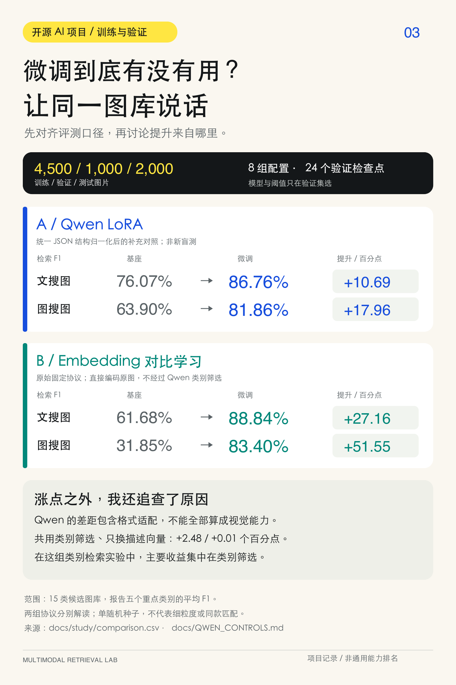
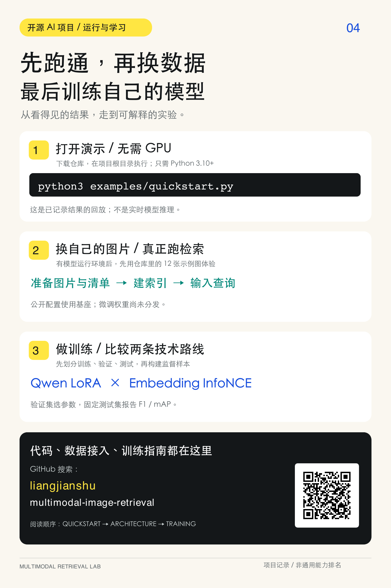

# 项目分享页：实验结果与上手指南

用于配合项目介绍封面、[技术框架图](../assets/retrieval-architecture.png)使用。两张图为 2:3 竖版、1440 × 2160 像素；PDF 共两页，页码标为 03 / 04，与整套内容顺序对应。

- [第三页：实验结果 PNG](page-03-results.png)
- [第四页：运行与学习 PNG](page-04-quickstart.png)
- [两页 PDF](learning-pages.pdf)
- [数值与源文件 SHA-256](learning-pages.json)
- [详细架构与源码导读](../ARCHITECTURE.md)

## 第三页：先对齐口径，再看提升



Qwen 数值来自统一 JSON 结构归一化后的补充对照，Embedding 数值来自原始固定协议，两者分开注明。提升按未四舍五入的原始数值计算，单位是百分点；不得删掉协议说明后宣传为纯模型视觉能力提升或通用能力排名。

主表为 2,000 张测试图库中五个重点类别的平均检索 F1。实验采用类别相关性、单随机种子；不证明颜色、材质或同款商品检索能力。完整数值和局限见 [固定实验](../RESTORED_STUDY.md)与 [Qwen 归因](../QWEN_CONTROLS.md)。

## 第四页：区分静态演示与真实推理



二维码指向本仓库，没有第三方跳转或跟踪参数。`quickstart.py` 只回放已有结果；真实推理需模型运行环境。默认公开配置使用基座，作者微调权重暂未分发。完整命令见 [QUICKSTART](../QUICKSTART.md)。

## 重新生成

排版使用 ReportLab，数值直接读取已发布的 CSV 和 JSON。图片由 PDF 渲染，避免人工重抄成绩。脚本不调用模型、不改变实验记录。

准备 `reportlab`、Poppler 的 `pdftoppm` 与合法可用的中文 TrueType 字体（字体不随仓库分发），在仓库根目录执行：

```bash
python examples/showcase/build_social_pages.py \
  --font /path/to/chinese-regular.ttf \
  --bold-font /path/to/chinese-bold.ttf

pdftoppm -r 144 -png docs/social/learning-pages.pdf /tmp/retrieval-page
cp /tmp/retrieval-page-1.png docs/social/page-03-results.png
cp /tmp/retrieval-page-2.png docs/social/page-04-quickstart.png
```

字体不同可能影响版面。发布前需检查两页没有溢出、裁切和乱码，再核对 `learning-pages.json` 与原始报告。
